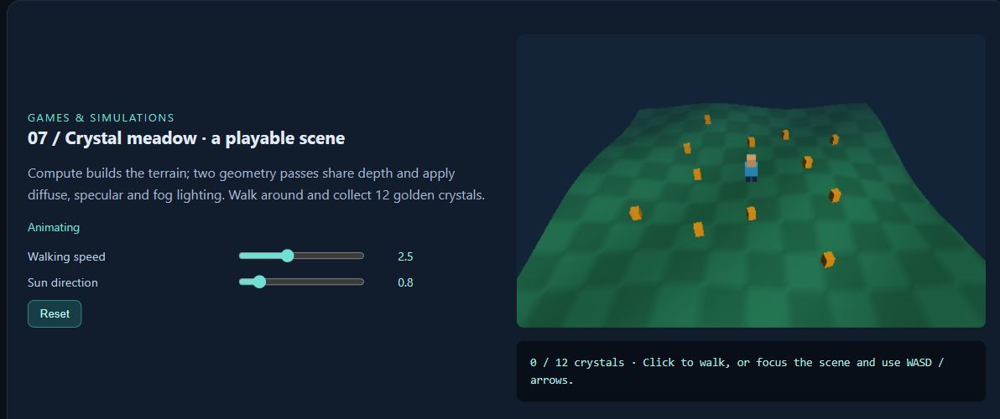
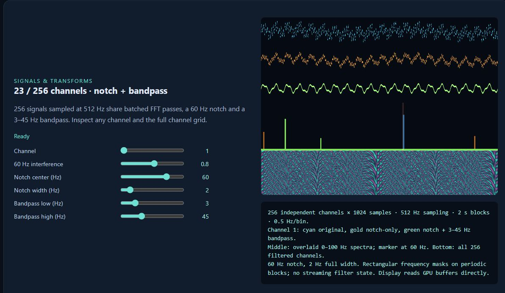
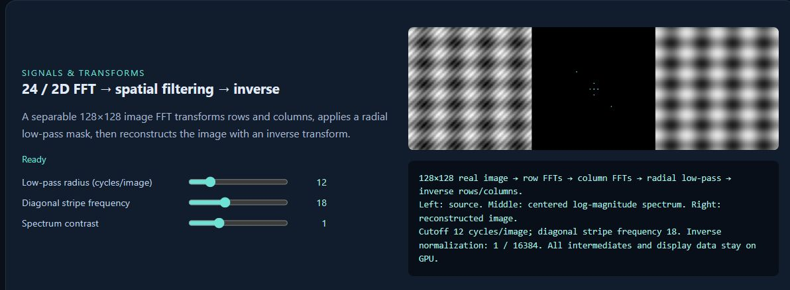
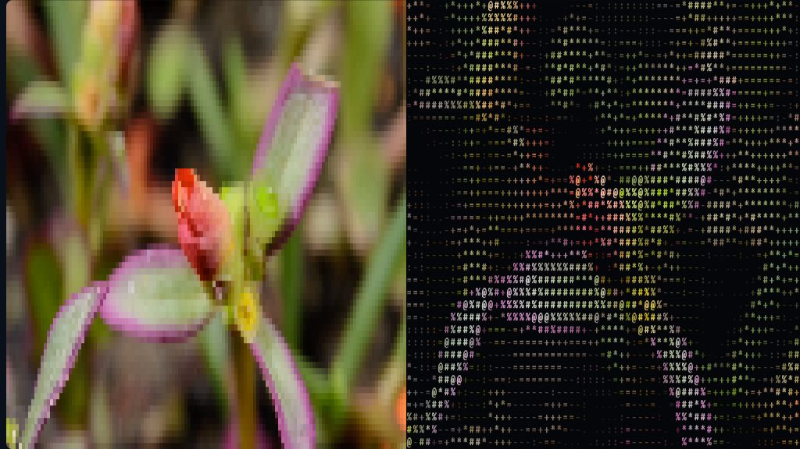
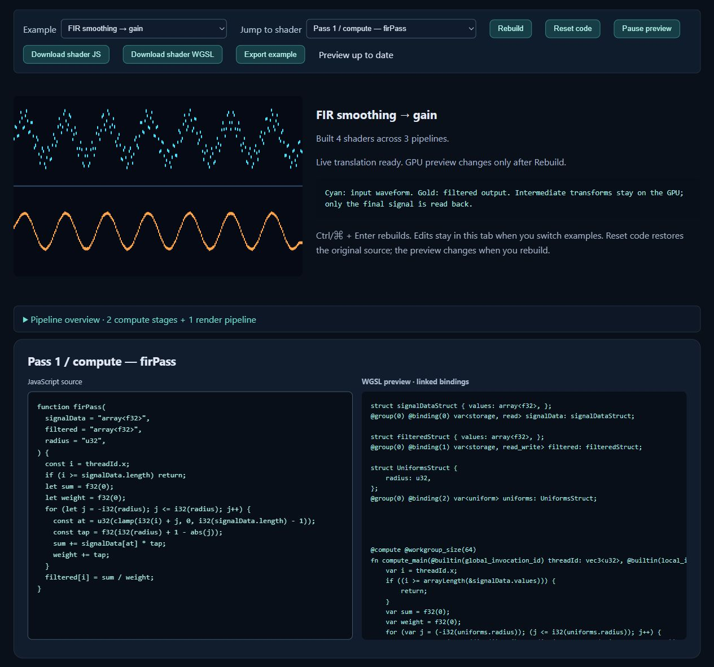
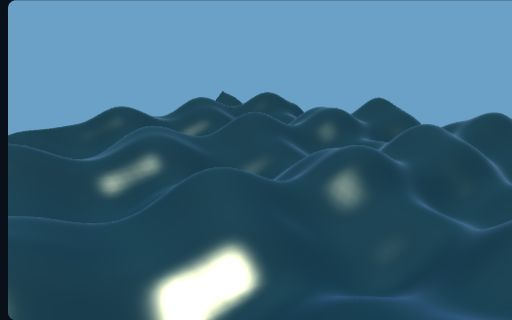

# WebGPUjs

[](https://www.npmjs.com/package/webgpujs)
[](https://www.npmjs.com/package/webgpujs)
[](LICENSE)
[](docs/API.md)

### Massively parallel, efficient compute and rendering - in plain JS!

Write compute, vertex and fragment shaders as plain JavaScript functions. WebGPUjs parses them into WGSL and handles bindings, buffers, uniforms and pipelines. Connect stages by variable name, add an explicit alias when names differ, and mix in native WGSL whenever you need it.

**[Explore 100 live examples →](https://webgpujs.netlify.app/)** · **[Open the shader editor →](https://webgpujs.netlify.app/editor.html)** · [API reference](docs/API.md) · [Shader built-ins and IDs](docs/SHADER-LANGUAGE.md) · [WebGPU coverage](WEBGPU-COVERAGE.md)

## Install or use a CDN

```sh
npm install webgpujs
```

```js
import { WebGPUjs } from "webgpujs";
// Default imports also work: import WebGPUjs from "webgpujs";
```

For a browser page with no build step, use the **1.0.0** CDN bundles below. Serve the page over HTTPS or localhost in a browser with WebGPU support.

**ESM — import directly from the CDN:**

```html
<script type="module">
  import { WebGPUjs } from "https://cdn.jsdelivr.net/npm/webgpujs@1.0.0/dist/webgpujs.esm.js";

  function double(values = "array<f32>") {
    const i = threadId.x;
    if (i < values.length) values[i] *= 2;
    return values;
  }

  const pipeline = await WebGPUjs.createPipeline(double);
  console.log(Array.from(await pipeline.process(new Float32Array([1, 2, 3])))); // [2, 4, 6]
  pipeline.dispose();
</script>
```

**Global — use a classic script tag:**

```html
<script src="https://cdn.jsdelivr.net/npm/webgpujs@1.0.0/dist/webgpujs.js"></script>
<script>
  (async () => {
    function double(values = "array<f32>") {
      const i = threadId.x;
      if (i < values.length) values[i] *= 2;
      return values;
    }

    const pipeline = await WebGPUjs.createPipeline(double);
    console.log(Array.from(await pipeline.process(new Float32Array([1, 2, 3])))); // [2, 4, 6]
    pipeline.dispose();
  })();
</script>
```

The classic bundle exposes the factory as `globalThis.WebGPUjs` and all runtime exports as `globalThis.WebGPUjsModule`. For example, use `WebGPUjsModule.WGSLTranspiler` to translate a shader directly.

**CDN files:** [ES module](https://cdn.jsdelivr.net/npm/webgpujs@1.0.0/dist/webgpujs.esm.js) · [Global script](https://cdn.jsdelivr.net/npm/webgpujs@1.0.0/dist/webgpujs.js) · [Published package](https://www.npmjs.com/package/webgpujs/v/1.0.0)

Bundled apps should preserve authored shader source before minifying; the optional [`webgpujs/esbuild` plugin](docs/API.md#supported-shader-language) handles that. The CDN snippets above run directly without a bundler.

[](https://webgpujs.netlify.app/#game)

_One compute stage, two render pipelines, shared depth and interactive controls. [Play Crystal meadow →](https://webgpujs.netlify.app/#game)_

## Less plumbing, more pipeline

A shader parameter such as `values = "array<f32>"` becomes a storage buffer. `scale = "f32"` becomes a packed uniform. The wrapper creates the matching WGSL declarations, layouts and bind groups. Your shader stays focused on the operation:

```js
function multiply(values = "array<f32>", scale = "f32") {
  const i = threadId.x;
  if (i < values.length) values[i] *= scale;
  return values;
}
```

For bundled apps, use the optional `preserveShaderSources()` plugin from `webgpujs/esbuild` with shader functions in `*.shaders.js` modules. It preserves parameter names even under minification. [Build setup →](docs/API.md#supported-shader-language)

The same idea extends across passes: an FFT can feed a filter, an inverse transform and a renderer without downloading the intermediate arrays. Ordinary compute chains encode their passes together and submit once. Read back when your application needs a CPU result.

| You write                                     | WebGPUjs handles                                  |
| --------------------------------------------- | ------------------------------------------------- |
| Functions and typed arrays                    | WGSL declarations, storage allocation and uploads |
| Scalar, vector and matrix inputs              | Uniform alignment and packing                     |
| An ordered list of compute passes             | Shared allocations and per-pass uniforms          |
| Matching names or explicit resource aliases   | Connections across JS and native WGSL stages      |
| Vertex/fragment functions and render settings | Layouts, pipelines and bind-group reuse           |

Shader code is parsed without executing it as JavaScript. The GPU runs compiled WGSL; parsing happens when you create or rebuild a pipeline. This is a shader-language subset, so arbitrary closures, objects and library calls are outside its scope. Native WGSL and native WebGPU descriptors provide the escape hatches. [Read the supported syntax and limits →](docs/API.md#supported-shader-language)

**Wondering where `f32()`, `distance()` or `threadId` comes from?** These are shader constructors, WGSL functions and stage inputs; they need no JS imports inside a shader. The [shader-language guide](docs/SHADER-LANGUAGE.md) explains them, lists the wrapper's automatic uniforms, and links every family in the official WGSL function catalog.

You can also [register your own automatic uniforms](docs/SHADER-LANGUAGE.md#add-your-own-automatic-uniforms): add a name with `{type, callback(context)}` to `WGSLTranspiler.builtInUniforms`, then reference that name inside a shader.

## Choose your starting point

Each workflow includes its shaders, allocation and execution. Start small, then add the pieces your application needs.

| Level | Complete workflow                                                           | What it introduces                                 | Related demo                                                                                                |
| ----- | --------------------------------------------------------------------------- | -------------------------------------------------- | ----------------------------------------------------------------------------------------------------------- |
| 1     | [One array operation](#1-one-array-operation)                               | Create, upload, dispatch, read back                | [Fourier transform](https://webgpujs.netlify.app/#dft)                                                      |
| 2     | [A chain with shared names](#2-a-chain-with-shared-names)                   | GPU-resident intermediates and deferred readback   | [Implicit chain](https://webgpujs.netlify.app/#implicit-chain)                                              |
| 3     | [JavaScript → native WGSL](#3-javascript--native-wgsl)                      | Explicit aliases and per-pass settings             | [FIR smoothing → gain](https://webgpujs.netlify.app/#fir)                                                   |
| 4     | [Interactive fragment graphics](#4-interactive-fragment-graphics)           | Canvas, uniforms and a host animation loop         | [Mandelbrot](https://webgpujs.netlify.app/#mandelbrot)                                                      |
| 5     | [Compute → render without readback](#5-compute--render-without-readback)    | One GPU allocation used by different shader stages | [Particle field](https://webgpujs.netlify.app/#particles)                                                   |
| 6     | [A cooperative parallel reduction](#6-a-cooperative-parallel-reduction)     | Workgroup memory, barriers and multiple dispatches | [Reduction](https://webgpujs.netlify.app/#reduction)                                                        |
| 7     | [Batched FFT → filters → inverse FFT](#7-batched-fft--filters--inverse-fft) | Reusable stages, ping-pong buffers and 256 signals | [Parallel signals](https://webgpujs.netlify.app/#batch-fft), [2D FFT](https://webgpujs.netlify.app/#fft-2d) |

## Run the gallery

```sh
npm install
npm run example
```

Open **[localhost:8080](http://localhost:8080/)**. The main page contains all 100 examples, grouped into graphics, WebGPU resources, games and simulations, signals, parallel algorithms, image processing and procedural visuals. Previews pause out of view; visited examples keep their setup. `tinybuild` also builds and serves the gallery and editor with live reload, from the root or `example/` folder. `tinybuild build` builds without starting a server.

**Source-first demos:** each example now lives in [its own folder](example/demos/README.md), with complete setup/update code, its shaders, controls and assets. The gallery and editor consume the same small [registry](example/demos/index.js). [Run the video demo alone](http://localhost:8080/demo.html?example=video-ascii), or use any example ID with `demo.html?example=…`.

**Package usage:** import the ESM package with `import { WebGPUjs } from "webgpujs"`. Declarations are included, with named chain readback shapes and native descriptor types. Use TypeScript 7+ and DOM libraries; there is no `@webgpu/types` dependency. [Installed-package checks and release guide →](docs/RELEASING.md)

**Running the workflows below:** each numbered code block is a separate `main.js` browser module. Run `npm run build`, copy `dist/webgpujs.esm.js` beside that module, and load it from a page served over localhost or HTTPS:

```html
<!doctype html>
<html lang="en">
  <meta charset="utf-8" />
  <title>My WebGPUjs workflow</title>
  <canvas id="gpu" width="768" height="384"></canvas>
  <script type="module" src="./main.js"></script>
</html>
```

For example, put that page, `main.js` and the copied library in `example/playground/`; the running gallery server exposes them at `http://localhost:8080/playground/`. Compute-only workflows print their results to the browser console. GPU built-ins such as `threadId`, `vec4f` and `workgroupBarrier` appear only inside shader functions; WebGPUjs translates those functions instead of calling them on the CPU. When bundling these functions, follow the [source-preservation guidance](docs/API.md#supported-shader-language).

## 1. One array operation

Upload three values, multiply them in parallel, and get a typed array back. A compute `return` selects the buffer to read; it does not return one CPU value per invocation.

```js
import { WebGPUjs } from "./webgpujs.esm.js";

function multiply(values = "array<f32>", scale = "f32") {
  const i = threadId.x;
  if (i < values.length) values[i] *= scale;
  return values;
}

const pipeline = await WebGPUjs.createPipeline(multiply);
const result = await pipeline.process(new Float32Array([1, 2, 3]), 2);
console.log(Array.from(result)); // [2, 4, 6]

// Named inputs let you update one setting and retain the GPU array.
const smaller = await pipeline.compute.run({ inputs: { scale: 0.5 } });
console.log(Array.from(smaller)); // [1, 2, 3]
```

`.process()` follows shader parameter order. Named inputs use shader parameter names. Omitted inputs retain their previous values; unknown names produce an error. Integer outputs retain their integer representation, and several returned buffers produce an object keyed by name.

## 2. A chain with shared names

Matching storage names connect automatically, even when their parameter order changes. This pipeline applies `x * 2 + 3` without a readback between operations.

```js
import { WebGPUjs } from "./webgpujs.esm.js";

function multiply(values = "array<f32>", scale = "f32") {
  const i = threadId.x;
  if (i < values.length) values[i] *= scale;
  return values;
}
function add(bias = "f32", values = "array<f32>") {
  const i = threadId.x;
  if (i < values.length) values[i] += bias;
  return values;
}

const chain = await WebGPUjs.createComputeChain([multiply, add]);
await chain.run({ values: new Float32Array([1, 2, 3]), scale: 2, bias: 3 });
// Both passes submitted. Nothing has been copied back to the CPU.

const result = await chain.read("values");
console.log(Array.from(result)); // [5, 7, 9]

// Or request the final readback as part of a run.
const next = await chain.run(
  { values: new Float32Array([10, 20]), scale: 2, bias: 3 },
  { readback: "values" },
);
console.log(Array.from(next)); // [23, 43]
```

**A chain suppresses the shaders' individual return readbacks.** Use `.read()` or `readback` for the final result. `chain.getBuffer("values")` exposes the native GPUBuffer for another GPU consumer. Provide every storage allocation on the first run, including scratch/output arrays; subsequent runs can reuse them. Independent per-pass uniforms allow ordinary chains to submit all passes together.

## 3. JavaScript → native WGSL

Here a JavaScript box filter feeds an existing WGSL gain kernel. The producer calls its output `filtered`; the consumer calls it `samples`. Both map to the shared allocation `output`.

```js
import { WebGPUjs } from "./webgpujs.esm.js";

function smooth(
  signalData = "array<f32>",
  filtered = "array<f32>",
  radius = "i32",
) {
  const i = threadId.x;
  if (i >= signalData.length) return;
  let sum = f32(0);
  for (let offset = -radius; offset <= radius; offset++) {
    const at = u32(clamp(i32(i) + offset, 0, i32(signalData.length) - 1));
    sum += signalData[at];
  }
  filtered[i] = sum / f32(radius * 2 + 1);
}

const nativeGain = `
struct Settings { gain: f32, };
@group(0) @binding(0) var<storage, read_write> samples: array<f32>;
@group(0) @binding(1) var<uniform> settings: Settings;
@compute @workgroup_size(64)
fn compute_main(@builtin(global_invocation_id) id: vec3<u32>) {
  if (id.x < arrayLength(&samples)) {
    samples[id.x] *= settings.gain;
  }
}`;

const chain = await WebGPUjs.createComputeChain([
  {
    shader: smooth,
    resources: { signalData: "input", filtered: "output" },
    inputs: { radius: 1 },
  },
  { shader: nativeGain, resources: { samples: "output" } },
]);
const result = await chain.run(
  {
    input: new Float32Array([0, 0, 1, 0, 0]),
    output: new Float32Array(5),
    gain: 1.5,
  },
  { readback: "output" },
);
console.log(Array.from(result)); // [0, 0.5, 0.5, 0.5, 0]
```

`resources` reads **shader parameter → shared allocation**. `inputs` fixes a uniform for one pass; `.run()` supplies shared names and unfixed uniforms. WGSL uniform fields such as `gain` are reflected by name. Strings are native WGSL by default, and native entry points default to `compute_main`, `vtx_main` and `frag_main`.

Numeric binding slots are separate from resource identity. The linker relocates compatible native bindings across a chain; use `resourceBindings` or `shaderBindings` when you need particular slots. [See explicit binding controls →](docs/API.md#explicit-bindings-across-compute-and-rendering)

## 4. Interactive fragment graphics

A fragment-only pipeline receives a fullscreen vertex shader automatically. This complete module draws animated rings around the pointer; the host handles input and timing while the GPU shades the pixels.

```js
import { WebGPUjs } from "./webgpujs.esm.js";

function rings(time = "f32", pointer = "vec2f") {
  const uv = position.xy / vec2f(resX, resY);
  const d = distance(uv, pointer);
  const glow = 0.5 + 0.5 * cos(d * 60 - time * 4);
  return vec4f(0.08 + glow * 0.15, glow * 0.85, 0.4 + glow * 0.6, 1);
}

const canvas = document.querySelector("#gpu");
const graphics = await WebGPUjs.createPipeline(rings, { canvas });
let pointer = [0.5, 0.5];
canvas.addEventListener("pointermove", (event) => {
  const rect = canvas.getBoundingClientRect();
  pointer = [
    (event.clientX - rect.left) / rect.width,
    (event.clientY - rect.top) / rect.height,
  ];
});
async function animate(milliseconds) {
  await graphics.render({ inputs: { time: milliseconds / 1000, pointer } });
  requestAnimationFrame(animate);
}
requestAnimationFrame(animate);
```

For custom geometry, supply `{vertex, fragment}` plus vertex/index buffers and draw settings. The [textured cube](https://webgpujs.netlify.app/#cube) adds matrix uniforms, an image, indexed drawing, depth and 4× multisampling. [Crystal meadow](https://webgpujs.netlify.app/#game) adds compute-generated terrain, separate geometry passes, shared depth, lighting and character controls. Their full setup and animation functions are shown in the gallery.

## 5. Compute → render without readback

Use `combineShaders()` when a compute producer feeds a renderer or a texture pass. Here `heights` in compute and `samples` in the fragment shader share one GPU allocation named `wave`. Each frame updates the data, then renders directly from it.

```js
import { WebGPUjs } from "./webgpujs.esm.js";

function makeWave(heights = "array<f32>", time = "f32") {
  const i = threadId.x;
  if (i < heights.length)
    heights[i] = 0.5 + 0.4 * sin(f32(i) * 0.08 - time * 2);
}
function drawWave(samples = "array<f32>") {
  const uv = position.xy / vec2f(resX, resY);
  const i = min(u32(uv.x * f32(samples.length)), samples.length - 1);
  return select(
    vec4f(0.02, 0.04, 0.08, 1),
    vec4f(0.2, 0.9, 0.75, 1),
    1 - uv.y < samples[i],
  );
}

const canvas = document.querySelector("#gpu");
const compute = await WebGPUjs.createPipeline(makeWave, {
  resourceBindings: { heights: { resource: "wave" } },
  computePass: { skipOutputDef: true },
});
compute.compute.buffer({ inputs: { heights: new Float32Array(256), time: 0 } });
const display = await WebGPUjs.combineShaders(
  drawWave,
  {
    canvas,
    resourceBindings: { samples: { resource: "wave" } },
    renderPass: { vbos: [], vertexCount: 3 },
  },
  compute,
);

async function animate(milliseconds) {
  await compute.compute.run({ inputs: { time: milliseconds / 1000 } });
  await display.render();
  requestAnimationFrame(animate);
}
requestAnimationFrame(animate);
```

A chain orders compute passes for you. With separate helpers, the host explicitly runs producers before consumers. For simulations that read neighboring values, keep separate previous/next buffers to avoid races. Texture producers and consumers use the same resource-alias idea; [generate → blur → sample](https://webgpujs.netlify.app/#texture-chain) shows the complete storage-texture and sampled-texture workflow.

## 6. A cooperative parallel reduction

Some algorithms benefit from shared workgroup memory. This two-pass sum reduces 256 values into four partial sums, then one total. All 64 lanes reach every barrier, including lanes beyond the input length.

```js
import { WebGPUjs } from "./webgpujs.esm.js";

function reduce(sourceValues = "array<f32>", partials = "array<f32>") {
  let value = f32(0);
  if (threadId.x < sourceValues.length) value = sourceValues[threadId.x];
  scratch[localIndex] = value;
  workgroupBarrier();
  for (let stride = u32(32); stride > 0; stride /= 2) {
    if (localIndex < stride)
      scratch[localIndex] += scratch[localIndex + stride];
    workgroupBarrier();
  }
  if (localIndex == 0) partials[workgroupId.x] = scratch[0];
}

const stageOptions = (groups) => ({
  workGroupSize: 64,
  workgroupVariables: { scratch: "array<f32,64>" },
  computePass: { workgroupsX: groups },
});
const chain = await WebGPUjs.createComputeChain([
  {
    shader: reduce,
    resources: { sourceValues: "input", partials: "partials" },
    options: stageOptions(4),
  },
  {
    shader: reduce,
    resources: { sourceValues: "partials", partials: "total" },
    options: stageOptions(1),
  },
]);
const total = await chain.run(
  {
    input: Float32Array.from({ length: 256 }, (_, i) => i + 1),
    partials: new Float32Array(4),
    total: new Float32Array(1),
  },
  { readback: "total" },
);
console.log(total[0]); // 32896
```

`workgroupVariables` declares GPU shared memory, not a host input. Use multidimensional workgroup shapes such as `[8,8]` with explicit dispatch counts for tiled algorithms. Also explore [matrix multiplication](https://webgpujs.netlify.app/#matrix), [prefix scans](https://webgpujs.netlify.app/#scan), [stream compaction](https://webgpujs.netlify.app/#compact), [run-length encoding](https://webgpujs.netlify.app/#rle) and [spatial binning](https://webgpujs.netlify.app/#spatial).

## 7. Batched FFT → filters → inverse FFT

[](https://webgpujs.netlify.app/#batch-fft)

The larger workflows reuse kernels instead of expanding one giant shader. This complete setup processes **256 independent channels sampled at 512 Hz**, with 1,024 samples per channel. A host loop builds the pass list; the GPU processes all channels in parallel.

Alongside the built library, copy the [channel kernels](example/demos/batch-fft/shaders.js) as `channel-shaders.js` and the [image kernels](example/demos/fft-2d/shaders.js) as `image-shaders.js` beside `main.js`. These are the actual JavaScript kernels used by the demos. The planner, allocations, filtering and readback below form the complete compute workflow:

```js
import { WebGPUjs } from "./webgpujs.esm.js";
import * as channelKernels from "./channel-shaders.js";
import * as imageKernels from "./image-shaders.js";
const kernels = { ...channelKernels, ...imageKernels };

// Reuse the same kernels with different per-pass uniforms and buffer routes.
function fftAxis(length, initial, direction = -1, stride = 1) {
  const stages = [];
  let current = initial;
  function append(shader, inputs) {
    const next = current === "fft-A" ? "fft-B" : "fft-A";
    stages.push({ shader, resources: { state: current, next }, inputs });
    current = next;
  }
  append(kernels.reverseFFTAxis, { axisLength: length, stride });
  for (let span = 2; span <= length; span *= 2)
    append(kernels.fftAxisButterfly, {
      axisLength: length,
      stride,
      span,
      direction,
    });
  return { stages, current };
}

const channelCount = 256,
  sampleCount = 1024,
  sampleRate = 512;
const length = channelCount * sampleCount;
const forward = fftAxis(sampleCount, "fft-A");
const inverse = fftAxis(sampleCount, "band-spectrum", 1);
const chain = await WebGPUjs.createComputeChain([
  {
    shader: kernels.packComplex,
    resources: { signalData: "input", next: "fft-A" },
  },
  ...forward.stages,
  {
    shader: kernels.notchSpectrum,
    resources: {
      state: forward.current,
      spectrum: "spectrum",
      notched: "notched",
    },
    inputs: { sampleCount, sampleRate, notchHz: 60, notchWidth: 2 },
  },
  {
    shader: kernels.bandpassSpectrum,
    resources: { state: "notched", next: "band-spectrum" },
    inputs: { sampleCount, sampleRate, lowHz: 3, highHz: 45 },
  },
  ...inverse.stages,
  {
    shader: kernels.unpackReal,
    resources: { state: inverse.current, result: "filtered" },
    inputs: { normalization: sampleCount },
  },
]);

// Channel-major input: input[channel * sampleCount + sample].
const input = Float32Array.from({ length }, (_, i) => {
  const channel = Math.floor(i / sampleCount);
  const time = (i % sampleCount) / sampleRate;
  return (
    Math.sin(2 * Math.PI * (10 + (channel % 24)) * time) +
    0.8 * Math.sin(2 * Math.PI * 60 * time)
  );
});
const buffers = Object.fromEntries(
  ["fft-A", "fft-B", "spectrum", "notched", "band-spectrum"].map((name) => [
    name,
    new Float32Array(length * 2),
  ]),
);
await chain.run({ input, ...buffers, filtered: new Float32Array(length) });
// No CPU copies between the FFT, filters and inverse FFT.
const filtered = await chain.read("filtered");
console.log(filtered.length); // 262144
console.log(filtered.slice(0, 8)); // First eight samples of channel zero.
```

The FFT length must be a power of two. These are two-second periodic blocks with 0.5 Hz bins and rectangular frequency masks, rather than a stateful streaming filter. The 3–45 Hz bandpass already excludes 60 Hz; the gallery adds a separate notch-only inverse branch so you can compare both effects. Its renderer reads the signal and spectrum buffers directly, without a CPU readback.

### Extend the same planner to two dimensions

Rows use stride 1; columns use stride `width`. Using the `fftAxis` function and imports above, this replaces the channel setup with a complete 128×128 image transform, radial low-pass and inverse transform:

```js
const width = 128,
  height = 128,
  length = width * height;
function fft2D(initial, direction = -1) {
  const rows = fftAxis(width, initial, direction, 1);
  const columns = fftAxis(height, rows.current, direction, width);
  return {
    stages: [...rows.stages, ...columns.stages],
    current: columns.current,
  };
}
const forward = fft2D("fft-A");
const inverse = fft2D("filtered-spectrum", 1);
const chain = await WebGPUjs.createComputeChain([
  {
    shader: kernels.synthesizeFFTImage,
    resources: { image: "image" },
    inputs: { width, height, stripeFrequency: 18 },
  },
  {
    shader: kernels.packComplex,
    resources: { signalData: "image", next: "fft-A" },
  },
  ...forward.stages,
  {
    shader: kernels.lowpassSpectrum2D,
    resources: {
      state: forward.current,
      spectrum: "spectrum",
      next: "filtered-spectrum",
    },
    inputs: { width, height, cutoff: 12 },
  },
  ...inverse.stages,
  {
    shader: kernels.unpackReal,
    resources: { state: inverse.current, result: "filtered" },
    inputs: { normalization: length },
  },
]);
const buffers = Object.fromEntries(
  ["fft-A", "fft-B", "spectrum", "filtered-spectrum"].map((name) => [
    name,
    new Float32Array(length * 2),
  ]),
);
const filtered = await chain.run(
  {
    image: new Float32Array(length),
    filtered: new Float32Array(length),
    ...buffers,
  },
  { readback: "filtered" },
);
console.log(filtered.length); // 16384 reconstructed pixels.
```

[](https://webgpujs.netlify.app/#fft-2d)

_[Try the 2D FFT controls →](https://webgpujs.netlify.app/#fft-2d) · [Full planners and GPU display setup](example/demos/fft-2d/index.js) · [Shader kernels](example/demos/fft-2d/shaders.js)_

## Streaming filters retain their state

FFT masks treat each block as a periodic signal. For continuous signals, the [streaming IIR demo](https://webgpujs.netlify.app/#streaming-biquad) carries two state values per channel per biquad into the next block. Its 256 channels run independently at a 512 Hz sample rate through a 60 Hz notch, 3 Hz high-pass and 45 Hz low-pass. Only new samples and settings need uploading.

The [complete setup](example/demos/streaming-biquad/index.js) builds the chain this way; each section uses the same shader with independent state:

```js
const filters = [
  coefficients("notch", 60, 30),
  coefficients("highpass", 3, Math.SQRT1_2),
  coefficients("lowpass", 45, Math.SQRT1_2),
];
const chain = await WebGPUjs.createComputeChain(
  filters.map((inputs, i) => ({
    shader: biquad,
    resources: {
      source: ["signal", "notched", "highpassed"][i],
      result: ["notched", "highpassed", "filtered"][i],
      state: "state-" + i,
    },
    inputs: { sampleCount: 128, ...inputs },
    options: { computePass: { workgroupsX: 4 } },
  })),
  { device },
);
// Allocate arrays once. Later run({signal: nextBlock}) retains all state buffers.
```

[Coefficients, allocations and animation](example/demos/streaming-biquad/index.js) · [Reusable biquad shader](example/demos/streaming-biquad/shaders.js) · [Independent CPU reference](example/demos/streaming-biquad/reference.js)

## Video and images can feed compute too

The [video/image → buffers → ASCII demo](https://webgpujs.netlify.app/#video-ascii) captures decoded frames into an RGBA buffer, computes luminance and Sobel features, then selects glyphs from an atlas. Its three passes share GPU data and submit together. A working CC0 sample loads automatically; local video and image files use the same path. Playback pauses when the preview leaves view.

[](https://webgpujs.netlify.app/#video-ascii)

Read the complete [media setup and lifecycle](example/demos/video-ascii/index.js) and [capture/feature/display shaders](example/demos/video-ascii/shaders.js), or [run it by itself locally](http://localhost:8080/demo.html?example=video-ascii). Normal texture inputs accept video elements, VideoFrames, images and canvases directly; a compute shader writes whichever storage-buffer layout your next pass needs.

## See the code change the picture

Every gallery example exposes its actual shaders, their linked WGSL, resource connections, setup and animation code. Open an example in the editor to get one editable window per shader, with generated WGSL alongside it.

[](https://webgpujs.netlify.app/editor.html?example=fir)

1. Choose an example and a shader, including native WGSL stages.
2. Edit the source. JavaScript translates live; the running preview stays on the last build.
3. Click **Rebuild** or press **Ctrl/⌘ + Enter** to rebuild the whole shader set. A failed build preserves the previous preview.
4. Download individual shaders or **Export example** for all sources, WGSL, setup and update code as JSON. Exports contain source, not a packaged application.

## Pick an algorithm, not just a visual

| Use case                 | Examples to explore                                                                                                                                                                                                                                                                                                                                                                                                               |
| ------------------------ | --------------------------------------------------------------------------------------------------------------------------------------------------------------------------------------------------------------------------------------------------------------------------------------------------------------------------------------------------------------------------------------------------------------------------------- |
| Streaming signals        | [256-channel IIR: 60 Hz notch → 3–45 Hz bandpass](https://webgpujs.netlify.app/#streaming-biquad), [overlap-add FIR](https://webgpujs.netlify.app/#overlap-add), [Hilbert envelope](https://webgpujs.netlify.app/#hilbert-envelope)                                                                                                                                                                                               |
| Frequency analysis       | [Batched FFT](https://webgpujs.netlify.app/#batch-fft), [2D FFT](https://webgpujs.netlify.app/#fft-2d), [STFT spectrogram](https://webgpujs.netlify.app/#stft), [coherence](https://webgpujs.netlify.app/#coherence), [phase correlation](https://webgpujs.netlify.app/#phase-correlation)                                                                                                                                        |
| Scans and statistics     | [Segmented scan](https://webgpujs.netlify.app/#segmented-scan), [Welford variance](https://webgpujs.netlify.app/#variance), [argmax](https://webgpujs.netlify.app/#argmax), [L2 norm](https://webgpujs.netlify.app/#l2-norm), [softmax](https://webgpujs.netlify.app/#softmax)                                                                                                                                                    |
| Linear algebra           | [Tiled matrix multiplication](https://webgpujs.netlify.app/#matrix), [CSR sparse matrix/vector](https://webgpujs.netlify.app/#sparse-matvec), [Jacobi solver](https://webgpujs.netlify.app/#jacobi), [batched dot products](https://webgpujs.netlify.app/#batched-dot), [cosine similarity](https://webgpujs.netlify.app/#cosine-similarity)                                                                                      |
| Search and organization  | [Sort](https://webgpujs.netlify.app/#sort), [compaction](https://webgpujs.netlify.app/#compact), [k-means](https://webgpujs.netlify.app/#kmeans), [atomic hash table](https://webgpujs.netlify.app/#gpu-hash), [graph BFS](https://webgpujs.netlify.app/#graph-bfs)                                                                                                                                                               |
| Image transforms         | [DCT compression](https://webgpujs.netlify.app/#dct-compression), [Haar wavelets](https://webgpujs.netlify.app/#haar-wavelet), [histogram equalization](https://webgpujs.netlify.app/#histogram-equalization), [median filter](https://webgpujs.netlify.app/#median-filter)                                                                                                                                                       |
| GPU-driven graphics      | [Generated mesh and normals](https://webgpujs.netlify.app/#mesh-normals), [culling → indirect draw](https://webgpujs.netlify.app/#indirect-culling), [deferred lighting](https://webgpujs.netlify.app/#deferred-lighting), [shadow map](https://webgpujs.netlify.app/#shadow-map), [stencil portal](https://webgpujs.netlify.app/#stencil-portal)                                                                                 |
| Native resource features | [Mip levels](https://webgpujs.netlify.app/#mipmaps), [texture arrays](https://webgpujs.netlify.app/#texture-array), [3D volume](https://webgpujs.netlify.app/#volume-texture), [cube reflection](https://webgpujs.netlify.app/#cube-reflection), [render bundles](https://webgpujs.netlify.app/#render-bundles), [timestamps](https://webgpujs.netlify.app/#timestamp-query), [f16](https://webgpujs.netlify.app/#half-precision) |
| Interactive worlds       | [Playable scene](https://webgpujs.netlify.app/#game), [cloth](https://webgpujs.netlify.app/#cloth), [flocking](https://webgpujs.netlify.app/#boids), [reaction diffusion](https://webgpujs.netlify.app/#reaction)                                                                                                                                                                                                                 |

[](https://webgpujs.netlify.app/#ocean)

The [3D water demo](example/demos/ocean/index.js) connects geometry compute, perspective vertex projection and reflective fragment lighting in one helper. Move the pointer to orbit; adjust wave height, roughness and sunlight. Algorithm previews also expose their data: change vector angles, scrub solver iterations, drag a cluster or choose a BFS source, then hover to inspect values. Small final readbacks provide numerical inspection while intermediate passes and rendering use shared GPU buffers.

The demos favor inspectable algorithms and numerical references. They are starting points for application work, rather than optimized FFT, sort or linear-algebra libraries. Measure upload, dispatch and readback together: GPU offloading pays off when enough parallel work amortizes those costs.

## Resource cleanup

Use `pipeline.dispose()` when a helper is finished, or `await chain.dispose()` to finish queued work and release its passes. Shared allocations stay alive for their remaining consumers. Caller-owned devices, textures and buffers stay caller-owned. [Ownership, device loss and native encoder lifetimes →](docs/API.md#resource-lifetime)

Run the [browser compatibility check](http://localhost:8080/verify.html) to build, execute, dispose and rebuild all 100 demos and download a report. [Recorded environments and release gates →](docs/COMPATIBILITY.md)

## Go deeper

- **[API reference](docs/API.md):** factories, named inputs, explicit bindings, textures, workgroups, native encoders and shader syntax.
- **[Shader built-ins and IDs](docs/SHADER-LANGUAGE.md):** casts, vector math, `threadId`, stage inputs, automatic uniforms and the complete WGSL function directory.
- **[WebGPU coverage](WEBGPU-COVERAGE.md):** supported wrapper features, tested native interoperability and remaining boundaries.
- **[Implementation notes](src/notes.md):** parser, linker, data packing and runtime responsibilities.
- **[Exported types](src/types.ts):** configuration and descriptor definitions.

```sh
npm test             # parser, linker, data layout, exports and scheduler
npm run test:gpu     # real GPU compilation, numerical checks and rendered pixels
npm run typecheck
npm run test:package -- --offline  # packed install + strict consumer types
npm run build        # library, declarations, gallery and editor
npm run benchmark    # cold and cached transpilation timings
```

The GPU suite uses the development-only Dawn runtime and needs an adapter. The gallery and tests preserve authored shader source before bundling; see [the build contract](docs/API.md#supported-shader-language). Screenshots above were captured from the local gallery and editor. The hosted demo stays at **[webgpujs.netlify.app](https://webgpujs.netlify.app/)**; repository changes appear there after deployment.
